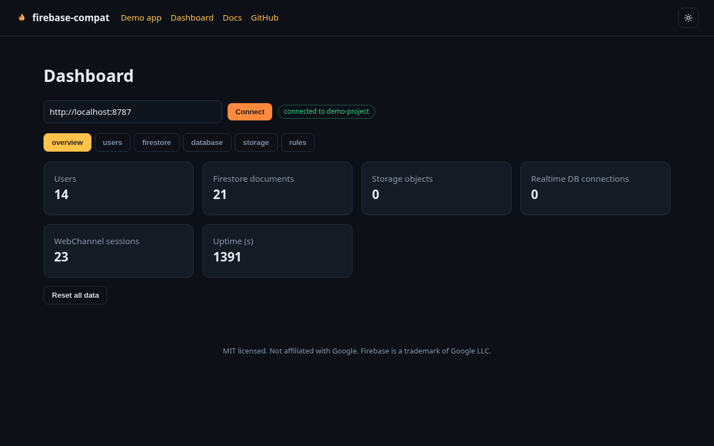
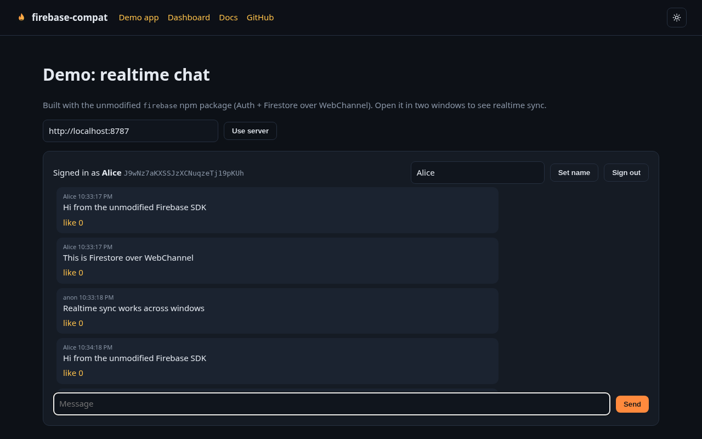
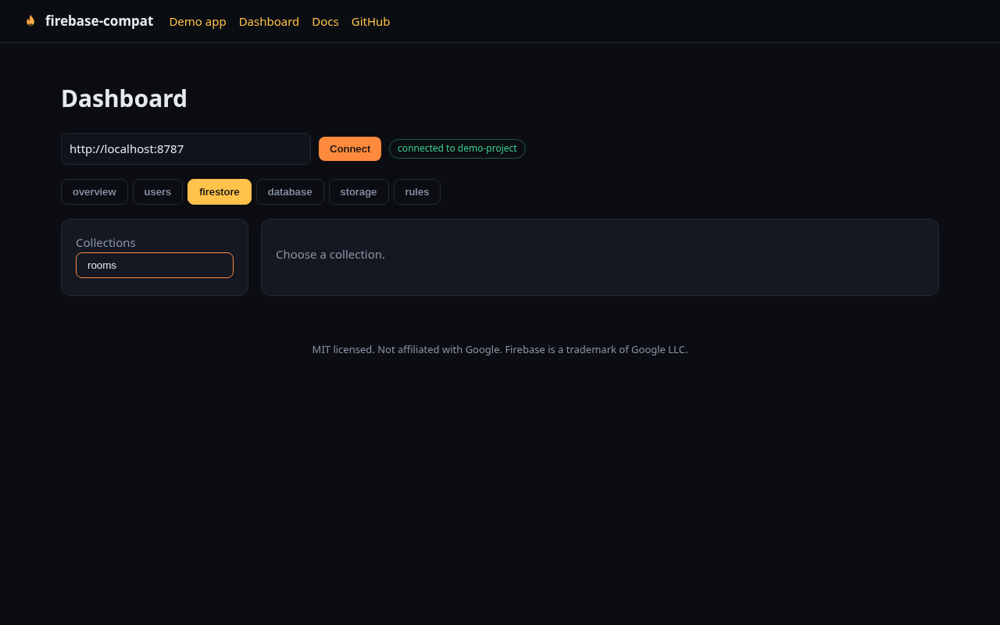
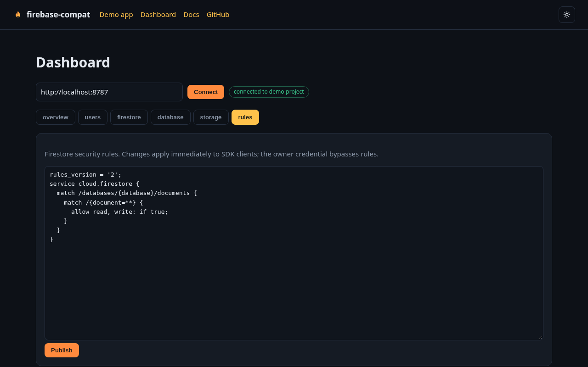

# firebase-compat

A self-hostable backend that the official, unmodified Firebase JS SDK talks to. Point `connectAuthEmulator`, `connectFirestoreEmulator`, `connectDatabaseEmulator` and `connectStorageEmulator` at one port and your app keeps working: Auth, Cloud Firestore, Realtime Database and Cloud Storage, persisted to a single SQLite file.

[](https://github.com/devtechedge/firebase-compat/actions/workflows/ci.yml)
[](LICENSE)

Website, dashboard and demo: https://firebase-compat.vercel.app (front end only; it connects to a server you run).



## Conformance

Every case runs the same SDK code against the official Firebase Emulator Suite and against firebase-compat, then compares normalised results. CI repeats this on every push.

| Suite | Cases | Matching emulator |
| --- | --- | --- |
| Auth | 19 | 19 |
| Firestore (Node, gRPC) | 40 | 40 |
| Realtime Database | 20 | 20 |
| Storage | 12 | 12 |
| **Total (firebase 13.1.0, Node)** | **91** | **91 (100%)** |
| Browser scenario (Auth + Firestore over WebChannel, Chromium) | 23 steps | 23 (100%) |

Details: [docs/compatibility.md](docs/compatibility.md) and [packages/conformance/results/report.md](packages/conformance/results/report.md).

## Quick start

With Docker:

```sh
docker compose up -d     # server on http://localhost:8787, data in a named volume
```

From source (Node 22.13 or newer):

```sh
pnpm install && pnpm build
node packages/server/dist/cli.js            # PORT, FIREBASE_PROJECT, DATA_FILE, FIRESTORE_RULES, ADMIN_TOKEN
```

In your app, unchanged except for the connect calls:

```ts
import { initializeApp } from "firebase/app";
import { getAuth, connectAuthEmulator } from "firebase/auth";
import { getFirestore, connectFirestoreEmulator } from "firebase/firestore";
import { getDatabase, connectDatabaseEmulator } from "firebase/database";
import { getStorage, connectStorageEmulator } from "firebase/storage";

const app = initializeApp({ apiKey: "any", projectId: "demo-project", storageBucket: "demo-project.appspot.com", databaseURL: "http://localhost:8787?ns=demo-project" });
connectAuthEmulator(getAuth(app), "http://localhost:8787", { disableWarnings: true });
connectFirestoreEmulator(getFirestore(app), "localhost", 8787);
connectDatabaseEmulator(getDatabase(app), "localhost", 8787);
connectStorageEmulator(getStorage(app), "localhost", 8787);
```

Then open https://firebase-compat.vercel.app/dashboard (or run `pnpm --filter @firebase-compat/web dev`) to browse users, documents, the database tree, files and rules.

## What works

- **Auth:** email and password, anonymous, custom tokens, profile and credential updates, delete, token refresh, RS256 ID tokens with JWKS.
- **Firestore:** CRUD, merges and field transforms, the full query surface (composite filters, cursors, collection groups, limitToLast), count/sum/avg, batches, transactions, realtime listeners over gRPC (Node) and WebChannel (browsers), REST v1, and a practical subset of security rules.
- **Realtime Database:** reads, writes, push, listeners, queries, transactions, onDisconnect, server values over the v5 WebSocket protocol.
- **Storage:** multipart and resumable uploads, metadata, download URLs, getBytes, list with pagination, delete.

Not supported yet: OAuth/phone/MFA sign in, RTDB and Storage rules, vector search, multiple Firestore databases. See [docs/limitations.md](docs/limitations.md).

## Repository layout

| Path | What |
| --- | --- |
| `packages/server` | The server (single port, gRPC + HTTP/1.1 + WebSocket, `node:sqlite`). 86 Vitest tests, most of them drive the real `firebase` SDK. |
| `packages/conformance` | 91 differential cases plus the runner and the latest results. |
| `apps/web` | Next.js landing page, dashboard, realtime chat demo and docs. |
| `specs/` | One SPEC.md per service: observed behaviour, quirks and unknowns, each tied to hashed evidence. |
| `evidence/` | Emulator HAR captures and REA analysis bundles with SHA-256 manifest. |
| `docs/` | [Architecture](docs/architecture.md), [compatibility](docs/compatibility.md), [evidence format](docs/evidence.md), [limitations](docs/limitations.md). |

## Development

```sh
pnpm install
pnpm test                                   # unit and SDK integration tests
cd packages/conformance/emulator && firebase emulators:start --project demo-compat &
node packages/conformance/src/run.mjs --target emulator
node packages/conformance/src/run.mjs --target compat
node packages/conformance/src/run.mjs --compare packages/conformance/results/emulator.json packages/conformance/results/compat.json
```

## Screenshots

| Demo chat | Firestore browser | Rules |
| --- | --- | --- |
|  |  |  |

## Clean room

Behaviour was derived from traffic captured between the public SDK and the official emulator, from the public npm bundles, and from the Apache 2.0 Firestore protocol buffers. No Google proprietary source code is included.

## License

MIT. Not affiliated with or endorsed by Google. Firebase is a trademark of Google LLC.
